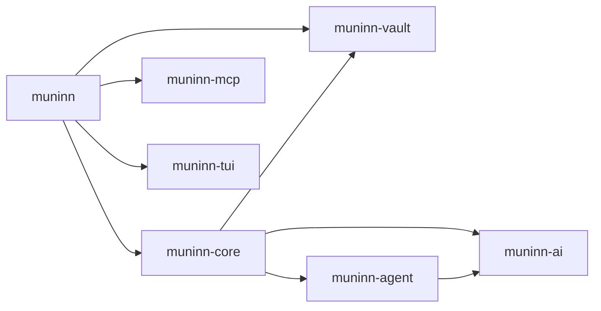

# AGENTS.md

Guide for agents (and humans) continuing work on Muninn. Read this first, then `README.md` (usage).

## What this is

Muninn is a librarian agent for one pinned knowledge vault (a folder of Markdown notes). You can reach it from any folder in three ways:

- `muninn` is a TUI chat for humans. On the first run it starts onboarding.
- `muninn ask "…"` is a one-shot CLI command with no chat mode.
- `muninn mcp` is an MCP server over stdio, used by coding agents. It exposes one tool, `muninn`, which takes a `message` and an optional `conversation_id`.

Muninn runs its own agent loop against OpenRouter (the default), Anthropic's Messages API, OpenAI, Gemini, or any OpenAI-compatible endpoint. It never shells out.

## Ground rules

- **Use the flake for everything dev-related.** Run commands as `nix develop -c <cmd>`, or work inside `nix develop`. Add new tools to `devShells.default` in `flake.nix`, never to the host. Flakes only see files git tracks, so `git add` new files before running `nix build` or `nix develop`.
- **Keep crates decoupled.** The library crates must stay usable outside Muninn (see the dependency rules below). Domain logic goes in `muninn-core`; UI and wiring go in the `muninn` binary.
- **Write concise, readable code.** Prefer boring designs, use no speculative abstraction, and delete dead code. Use `anyhow` for errors and `parking_lot` locks in sync code; use `tokio::sync` when a guard is held across `.await`. rustfmt is set to `max_width = 120` (`rustfmt.toml`).
- **Commit with git at every commitable step**, with a short imperative message. Commit only what the build, users, or contributors need: code, manifests, the flake, CI workflows, docs, and `assets/demo-tui.gif`. Stage files by name (no `git add -A` or `git add .`); screenshots, recordings, and personal notes stay out of git. **Never add commit attribution**: no `Co-Authored-By` and no "generated with" lines.
- **Never point tests or smoke runs at a real vault.** Use temporary folders.

## Commands

```sh
nix develop -c cargo test --workspace                                   # all tests
nix develop -c cargo clippy --workspace --all-targets --all-features    # must be warning-free
nix develop -c cargo fmt --all
nix build                       # release binary at ./result/bin/muninn; runs the test suite too
nix develop -c cargo run -p muninn-ai --features mock --example mock_server -- script.json 18431
git tag v0.1.0 && git push origin v0.1.0                              # release: CI builds Linux and macOS binaries
```

When `Cargo.lock` changes, `nix build` picks it up automatically through `cargoLock.lockFile`.

## Architecture



| Crate | Files | Responsibility | Must not know about |
|---|---|---|---|
| `muninn-ai` | `types.rs` (`Message`, `ToolCall`, `ToolSpec`, `Provider`), `openai.rs` (OpenAI-format streaming client, model list), `anthropic.rs` (Messages API client, prompt caching), `sse.rs`, `mock.rs` (feature `mock`) | LLM wire protocol | tools, vaults, Muninn |
| `muninn-agent` | `lib.rs` (`Agent`, `Tool`, `Event`, `Stop`) | tool-calling loop, cancellation, valid transcripts | vaults, UI |
| `muninn-vault` | `lib.rs` (`Vault`), `journal.rs` (`Journal`, `Undo`, `unified_diff`) | sandboxed file access, change log, undo | AI, UI |
| `muninn-mcp` | `lib.rs` (`Handler`, `serve`, `serve_stdio`) | MCP JSON-RPC (tools only) | Muninn |
| `muninn-tui` | `input.rs`, `chat_log.rs`, `markdown.rs` (pulldown-cmark → styled lines), `diff.rs`, `picker.rs`, `terminal.rs`, `wrap.rs` | generic ratatui widgets | Muninn |
| `muninn-core` | `config.rs` (`Settings`, `Paths`), `provider.rs` (`ProviderKind`, `connect`, `list_models`), `conversation.rs` (`Conversation`, `Store`, `Proposal`, `NoteEvent`), `tools.rs` (vault tools), `prompt.rs`, `librarian.rs` (`Librarian::turn`, `Review`, `Reviewer`, `Update`) | the librarian, independent of any UI | terminals, MCP |
| `muninn` | `main.rs` (clap), `cli.rs`, `mcp.rs`, `integrations.rs`, `tui/{mod,chat,commands,model,setup}.rs` | surfaces and onboarding | — |

### One turn

1. A surface builds a `Conversation` (`Surface::Cli|Mcp|Tui`, `Kind::Chat|Onboarding`). The TUI and MCP load existing conversations from `Store`.
2. It calls `Librarian::turn(conv, text, review, on_update, cancel)`.
3. `Librarian::turn` re-reads `ignore` from the settings file and applies it with `Vault::set_ignore`. Then `prompt::system_prompt` is rebuilt. It contains the role text, the surface-specific review text, the current `AGENTS.md` and root `MUNINN.md` (`MUNINN.md` wins on conflicts), and the vault tree without hidden entries. For onboarding, it adds the onboarding section.
4. `tools::toolset` creates the tools over a shared `TurnContext` (vault, journal, review mode, pending proposals, note events). `Agent::run` loops until the model replies without calling any tools. Each request goes through `muninn_agent::fit`, which keeps it within `CONTEXT_CHARS` (`librarian.rs`). First, tool results from earlier turns are replaced with a stub; then the oldest turns are dropped. The stored history stays complete.
5. If the reply names a note the model saw only as a search match (`cited_unread`), `Librarian::turn` sends one automatic follow-up asking it to read the note and answer again. The follow-up is a user-role message marked in `extra` (`is_automatic`); it doesn't count as a user turn, and the TUI hides it.
6. The surface renders `Update`s (`Text`, `Tool`, `Note`, `Recheck`) as they stream in. After `Recheck`, the answer that follows replaces the one before. Afterwards it saves the conversation; the CLI does not save.

### Settings and data

- `Paths::from_env` decides where files live. Settings are in `~/.config/muninn/config.toml`, with mode 0600 because the file holds the key; `MUNINN_CONFIG_DIR` overrides the location.
- Conversations are in `~/.local/share/muninn/conversations/<id>.json` and the change log is in `changes.jsonl`; `MUNINN_DATA_DIR` overrides the location.
- Keys are stored per provider (`api_keys`). `Settings::key_for` reads `MUNINN_API_KEY` first, then the stored key, then the provider's own variable (`ANTHROPIC_API_KEY`, …). Settings with the old single `api_key` migrate on load: the provider is taken from the endpoint, or `custom` for an unknown one.

## Invariants (do not break; tests cover most)

- **Vault sandbox.** `Vault::resolve` rejects `..`, absolute paths outside the root, symlinks that lead outside the vault, and paths matching the `ignore` patterns (gitignore syntax, default `.git/`; checked on both the written path and the symlink target). All file access goes through `Vault`.
- **Hidden entries are read-only.** Paths with a component starting with `.` can be read by path. Listings show them only with `hidden=true`, and a search walks into one only when it's the search root. `Vault::put` and `Vault::create_folder` refuse them, including through symlinks.
- **Every note write goes through `Journal::apply`**, so it can be undone. `Journal::undo` reports `Conflict` instead of overwriting a note that was edited afterwards.
- **Changes to an existing rules file always go through review**, whatever the model asks for: any `AGENTS.md`, and the `MUNINN.md` at the vault root (`VaultTool::save` in `core/src/tools.rs`). A `muninn.md` in a subfolder is an ordinary note.
- **`MEMORY.md` at the vault root is always reviewed**, including when it's created, and writes over `MEMORY_LIMIT` (3,000 characters) are refused. `muninn mcp` puts it into the MCP `instructions` (Claude Code cuts those at 4,096 characters), and `muninn memory` prints it for session-start hooks.
- **Review modes.**
  - TUI and CLI use `Review::Interactive`: the tool waits while a `Reviewer` asks a human (a channel to the TUI dialog, or `/dev/tty` in the CLI).
  - MCP uses `Review::Deferred`: the proposal is stored on the conversation, and `apply_pending_change` refuses to run until a later user turn exists (`Proposal.user_turn`). The diff is appended to the MCP reply by `muninn/src/mcp.rs::render`.
  - An interactive turn on a conversation with pending proposals (started over MCP) also gets `apply_pending_change` and `discard_pending_change`. Applying goes through the `Reviewer`, so a human approves it live.
- **Provider data round-trips.** `Message::extra` and `ToolCall::extra` hold data a provider needs back unchanged: Anthropic's raw content blocks, including thinking signatures, and Gemini's `extra_content` thought signatures. The agent stores replies as they came, and providers ignore other providers' keys.
- **Valid transcripts.** `Agent::run` answers every tool call, including on errors and cancellation. Tool errors go back to the model as `Error: …`.
- **Rules live in the vault.** Muninn's settings hold only the vault path, provider, model, custom endpoint, keys, and the `ignore` patterns. `ignore` sets access limits, not conventions, and it must stay where the model can't edit it. Never store vault conventions in Muninn's settings; they go in `AGENTS.md`, or in `MUNINN.md` when they apply to Muninn alone.
- **No shell.** If a vault rule needs a command, Muninn says so instead of running anything.

## Testing

- Unit tests sit next to the code (`#[cfg(test)]`). End-to-end tests are in `crates/muninn/tests/e2e.rs`. They run the real binary against `muninn_ai::mock::MockServer`, with temporary vault, config, data, and `HOME` folders.
  - `MockServer::scripted(vec![...])` replays fixed assistant messages.
  - `MockServer::start(|request_body| ...)` decides each reply from the request, for example to echo a generated proposal id.
- Test behavior that users or callers can see: boundaries, refusals, persistence, protocol. Don't write tests that only check wiring or wording.
- For TUI smoke tests, use tmux from the dev shell against the mock example. Run in an isolated environment (`HOME`, `MUNINN_CONFIG_DIR`, `MUNINN_DATA_DIR`) and set `PATH` without the real `claude`, `codex`, or `omp`, so onboarding can't edit real agent configs:
  ```sh
  tmux -L t new-session -d -s m -x 120 -y 36 "env HOME=/tmp/x/home MUNINN_CONFIG_DIR=/tmp/x/cfg MUNINN_DATA_DIR=/tmp/x/data muninn"
  tmux -L t send-keys -t m 'text' Enter; tmux -L t capture-pane -p -t m
  ```
- Claude Code smoke test: `claude -p "…use the muninn tool…" --mcp-config cfg.json --strict-mcp-config --allowedTools mcp__muninn__muninn`. Point `cfg.json` at the binary, and use `env` to set `MUNINN_CONFIG_DIR` to a config whose `base_url` is the mock server.

## Common changes

- **New vault tool:** add a `Kind` variant in `core/src/tools.rs`, its `spec()` entry, and its `call()` branch. Register it in `toolset`. Writes must go through `VaultTool::save` or `TurnContext::write`. Mention the tool in `prompt.rs` if the model needs guidance.
- **New provider or wire format:** implement `muninn_ai::Provider` in `muninn-ai`, then choose it in `Librarian::from_settings`. Add any new settings field to `Settings` (with a serde default) and to onboarding (`tui/setup.rs`).
- **New coding-agent integration:** add an `Agent` variant in `muninn/src/integrations.rs` (`name`, `binary`, `config` (honour the agent's config-dir variable), `registered`, and its arm in `install`, which replaces an existing entry). Prefer the agent's own CLI (`<agent> mcp add`) over editing its config files.
- **Prompt behavior:** edit `core/src/prompt.rs`. Surface-specific instructions go in `surface_text`, and the onboarding flow in `ONBOARDING`.
- **TUI:** generic widgets belong in `muninn-tui`. Screens and state belong in `muninn/src/tui/`. Background work reports back to the UI loop through `AppEvent` on the `Tx` channel.
- **Slash command:** add an `Action` variant and a `COMMANDS` entry in `muninn/src/tui/commands.rs`, then its arm in `Chat::run` (`tui/chat.rs`). The `/help` table and the completion list come from `COMMANDS`. Commands that touch the conversation or the vault must refuse while a turn runs.

## Backlog / known gaps

- Context fitting drops old turns rather than summarizing them, and `CONTEXT_CHARS` is fixed. Models with a context smaller than about 100k tokens (small local models) need a smaller budget.
- The CLI cannot confirm changes without a terminal (`/dev/tty`). In that case changes needing review are rejected.
- Later: structure presets, imports from other tools, and a calibration run before going live.
