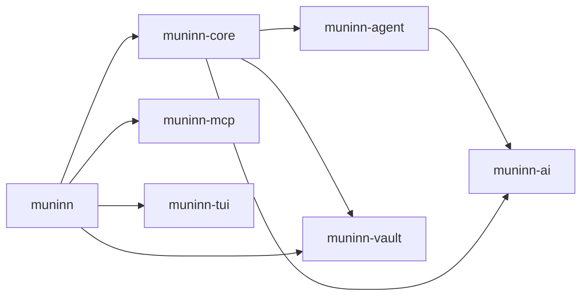

# Muninn

Your knowledge vault, reachable from anywhere. Pin the vault once; then save to it, ask it, or talk with it from any folder or any coding agent. The design is in [Muninn.md](Muninn.md).

## Use

```sh
muninn                      # TUI conversation in your vault (onboarding on first run)
muninn init                 # restart onboarding
muninn ask "save: ravens remember faces"     # one prompt in, one result out
echo "what did I decide about storage?" | muninn ask
muninn log                  # changes Muninn made
muninn undo [change-id]     # revert the latest (or a given) change
muninn mcp                  # MCP server over stdio, started by your agent
```

Onboarding asks for the vault folder and an OpenAI-compatible endpoint, model, and API key (OpenRouter by default), makes one test call, offers to register `muninn mcp` with Claude Code, Codex, and omp, and then works out the vault's rules (`AGENTS.md`) in conversation.

| Where | Path |
|---|---|
| Settings (vault, endpoint, model, key) | `~/.config/muninn/config.toml` (`MUNINN_CONFIG_DIR`) |
| Conversations, change log | `~/.local/share/muninn/` (`MUNINN_DATA_DIR`) |
| API key override | `MUNINN_API_KEY` |

Muninn reads, searches, and writes notes inside the vault only, never hidden folders and never outside the root. It has no shell. When the vault's rules require review, changes are shown first: in the TUI as an approve dialog, in `muninn ask` as a terminal prompt, and over MCP as a pending diff that the calling agent approves by replying in the same conversation (`conversation_id`).

### Add to an agent by hand

```sh
claude mcp add --scope user muninn -- muninn mcp
codex mcp add muninn -- muninn mcp
```

## Develop

Everything runs through the flake:

```sh
nix develop                 # rustc, cargo, clippy, rustfmt, rust-analyzer, tmux
cargo test --workspace
cargo clippy --workspace --all-targets --all-features
nix build                   # release binary in ./result/bin/muninn (runs the tests)
nix run . -- ask "hello"
```

Try it offline against a scripted model:

```sh
cargo run -p muninn-ai --features mock --example mock_server -- script.json 18431
# then use http://127.0.0.1:18431/v1 as the endpoint (any key)
```

### Crates

Each crate stands alone; only `muninn-core` and the binary know what Muninn is.

| Crate | What it is | Depends on |
|---|---|---|
| `muninn-ai` | Chat types, `Provider` trait, streaming OpenAI-compatible client, mock server (`mock` feature) | — |
| `muninn-agent` | Tool-calling agent loop with events and cancellation | `muninn-ai` |
| `muninn-vault` | Sandboxed vault access (tree, read, search, write) and the undoable change journal | — |
| `muninn-mcp` | Tools-only MCP server over stdio JSON-RPC | — |
| `muninn-tui` | ratatui pieces: terminal guard, input editor, chat log, diff view, picker | — |
| `muninn-core` | The librarian: settings, conversations, vault tools, prompts, review flow | ai, agent, vault |
| `muninn` | The binary: CLI, MCP surface, TUI app, onboarding, agent integration | core, mcp, tui, vault |


