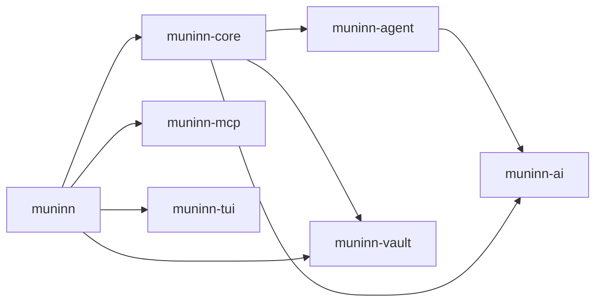

# Muninn

Your knowledge vault, reachable from anywhere. Pin the vault once; then save to it, ask it, or talk with it from any folder or any coding agent.


## Install

Muninn is pre-release. Until the first tagged release, build it from source:

```sh
nix profile install github:hhyurdagul/muninn                          # with Nix
cargo install --locked --git https://github.com/hhyurdagul/muninn muninn   # with a stable Rust toolchain
```

Tagged releases will also ship prebuilt binaries for Linux (x86_64, arm64) and macOS (arm64, x86_64). Muninn talks to a model provider of your choice, so you need an API key; the default is `deepseek/deepseek-v4.1-flash` on [OpenRouter](https://openrouter.ai/keys).

## Use

```sh
muninn                      # TUI conversation in your vault (onboarding on first run)
muninn init                 # restart onboarding
muninn ask "save: ravens remember faces"     # one prompt in, one result out
echo "what did I decide about storage?" | muninn ask
muninn model                # current provider and model
muninn model anthropic      # list a provider's models
muninn model anthropic claude-sonnet-5-5     # switch
muninn memory               # print MEMORY.md, the short memory agents load at startup
muninn log                  # changes Muninn made
muninn undo [change-id]     # revert the latest (or a given) change
muninn mcp                  # MCP server over stdio, started by your agent
```

Onboarding asks for the vault folder, then a provider, API key, and model (see [Models](#models)), offers to register `muninn mcp` with Claude Code, Codex, and omp, and then works out the vault's rules in conversation. That includes whether Muninn should get rules of its own.

| Where | Path |
|---|---|
| Settings (vault, provider, model, keys, ignore patterns) | `~/.config/muninn/config.toml` (`MUNINN_CONFIG_DIR`) |
| Conversations, change log | `~/.local/share/muninn/` (`MUNINN_DATA_DIR`) |
| API keys from the environment | `MUNINN_API_KEY` (any provider), else the stored key, else the provider's own variable |

Muninn reads, searches, and writes notes inside the vault only, never outside the root. It has no shell. When the vault's rules require review, changes are shown first: in the TUI as an approve dialog, in `muninn ask` as a terminal prompt, and over MCP as a pending diff that the calling agent approves by replying in the same conversation (`conversation_id`).

### Vault rules

`AGENTS.md` at the vault root holds the rules every agent in the vault follows. If Muninn needs rules that other agents shouldn't follow (or the other way round), put those in `MUNINN.md` at the root. Muninn follows both, and `MUNINN.md` wins where they disagree. Onboarding asks whether you want the split. Muninn changes an existing `AGENTS.md` or root `MUNINN.md` only after review.

### Models

| Provider | How Muninn talks to it | Key variable |
|---|---|---|
| OpenRouter (default; model `deepseek/deepseek-v4.1-flash`) | OpenAI format | `OPENROUTER_API_KEY` |
| Anthropic | Anthropic's Messages API, with prompt caching | `ANTHROPIC_API_KEY` |
| OpenAI | OpenAI format | `OPENAI_API_KEY` |
| Gemini | Google's OpenAI-compatible endpoint | `GEMINI_API_KEY` |
| Custom | any OpenAI-compatible endpoint (Ollama, LM Studio, vLLM); key optional | — |

Switch with `/model` in the TUI, which lists the provider's models as you type, or with `muninn model <provider> <model>` (add `--endpoint <url>` for a custom one). Switching sends nothing to the model; your first message shows whether the key and model work. Keys are kept per provider, so switching back doesn't ask again. Talking to Anthropic directly needs an API key from the [Claude Console](https://console.anthropic.com); a Claude Pro or Max subscription can't be used in third-party apps. Gemini's free tier is tight for an agent: Gemini 3.x Flash allows 5 requests a minute and 20 a day, and one Muninn turn makes 3 to 8 requests.

### Memory

`MEMORY.md` at the vault root is the short memory about you that every agent gets when it starts: who you are, what you're working on, standing preferences, and recent decisions. `muninn mcp` puts it in its MCP server instructions, so Claude Code and other MCP clients see it at the start of every session without calling a tool. Agents that don't read server instructions can load it with `muninn memory` from a session-start hook.

Muninn keeps the file up to date: ask it to remember something, or let it notice when a save changes one of these facts. Every change to `MEMORY.md` goes through review, because a wrong line would mislead every agent that loads it. The file is capped at 3,000 characters so that it fits in the 4,096 characters Claude Code keeps of server instructions. Details belong in notes, which `MEMORY.md` links to.

### Hidden files and ignore patterns

Hidden files and folders (`.obsidian`, `.agents`, …) are read-only for Muninn. They are left out of its listings and searches unless it asks for them (`list_notes` with `hidden=true`, or a search inside a named hidden folder), but it can read them by path. Muninn never writes them.

`ignore` in `config.toml` takes gitignore-style patterns, relative to the vault root, for paths Muninn can't list, search, read, or write. Muninn re-reads them before every turn, so edits apply without a restart:

```toml
ignore = [".git/", ".stversions/", "private/", "*.key", "!private/shared.md"]
```

The default is `[".git/"]`.

### In the TUI

Muninn's replies render as Markdown: headings, emphasis, lists and task lists, quotes and `> [!NOTE]` alerts, code blocks, tables, links, `[[wikilinks]]`, footnotes, and `$math$` (shown as source).

| Command | What it does |
|---|---|
| `/help` | Commands and keyboard shortcuts |
| `/new` | Start a new conversation (Ctrl+N) |
| `/resume` | Continue an earlier conversation (Ctrl+O) |
| `/log` | Recent changes Muninn made to the vault |
| `/undo [id]` | Revert the latest change, or the one with this id |
| `/model` | Switch the provider or model |
| `/init` | Redo setup and onboarding |
| `/quit`, `/exit` | Leave (Ctrl+C) |

Typing `/` opens the command list (↑↓ select, Tab complete, Enter run). Enter sends; Ctrl+Enter, Shift+Enter, Alt+Enter, or Ctrl+J insert a new line. Ctrl/Alt+←→ move by word, Ctrl/Alt+Backspace and Ctrl+W delete a word, Ctrl+Delete and Alt+D delete the next word, Ctrl+U and Ctrl+K delete to the line's start or end, and Ctrl+Home/End jump to the message's start or end. On macOS, Cmd+←→, Cmd+↑↓, and Cmd+Backspace work too. Ctrl+Enter, Shift+Enter, and Cmd need a terminal with the kitty keyboard protocol (kitty, Ghostty, WezTerm, foot, iTerm2); Alt+Enter and Ctrl+J work everywhere.

### Add to an agent by hand

```sh
claude mcp add --scope user muninn -- muninn mcp
codex mcp add muninn -- muninn mcp
```

For omp, add `"muninn": {"type": "stdio", "command": "muninn", "args": ["mcp"]}` under `mcpServers` in `~/.omp/agent/mcp.json`.

Codex asks before every MCP tool call, and `codex exec` refuses such calls outright. To let Codex call Muninn without asking, add `default_tools_approval_mode = "approve"` under `[mcp_servers.muninn]` in `~/.codex/config.toml`. Saves can then land in your vault without a prompt.

## Develop

Everything runs through the flake:

```sh
nix develop                 # rustc, cargo, clippy, rustfmt, rust-analyzer, tmux
cargo test --workspace
cargo clippy --workspace --all-targets --all-features
nix build                   # release binary in ./result/bin/muninn (runs the tests)
nix run . -- ask "hello"
```

Try it offline against a scripted model:

```sh
cargo run -p muninn-ai --features mock --example mock_server -- script.json 18431
# then use http://127.0.0.1:18431/v1 as the endpoint (any key)
```

### Crates

Each crate stands alone; only `muninn-core` and the binary know what Muninn is.

| Crate | What it is | Depends on |
|---|---|---|
| `muninn-ai` | Chat types, `Provider` trait, streaming OpenAI-compatible client, mock server (`mock` feature) | — |
| `muninn-agent` | Tool-calling agent loop with events and cancellation | `muninn-ai` |
| `muninn-vault` | Sandboxed vault access (tree, read, search, write) and the undoable change journal | — |
| `muninn-mcp` | Tools-only MCP server over stdio JSON-RPC | — |
| `muninn-tui` | ratatui pieces: terminal guard, input editor, chat log, Markdown renderer, diff view, picker | — |
| `muninn-core` | The librarian: settings, conversations, vault tools, prompts, review flow | ai, agent, vault |
| `muninn` | The binary: CLI, MCP surface, TUI app, onboarding, agent integration | core, mcp, tui, vault |



## License

Apache License 2.0; see [LICENSE](LICENSE). Use it, copy it, and change it freely. If you redistribute Muninn or build on it, keep the [NOTICE](NOTICE) file, which credits this project.
